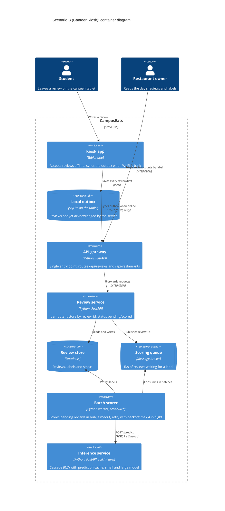

# Task 4: Deployment topologies and trade-offs

**Name / ชื่อ:** กฤษดา จันทร์อินทร์

**Student ID / รหัสนิสิต:** 6630016821

This is **individual work**: each student completes and submits their own copy, in their own fork.

*งานนี้เป็น**งานเดี่ยว** นิสิตแต่ละคนทำและส่งงานของตัวเอง ใน fork ของตัวเอง*

**Scenario (A, B or C) / Scenario ที่เลือก:** B. Canteen kiosk

Choose **one** scenario below. If the last digit of your student ID is odd, take A or B; if it is even, take B or C. Use your measurements from Tutorial 6 as evidence: cite run names from `results/runs.csv`. Answer in Thai or English.

เลือก scenario **หนึ่ง** ข้อด้านล่าง ถ้าเลขตัวสุดท้ายของรหัสนิสิตเป็นเลขคี่ ให้เลือก A หรือ B ถ้าเป็นเลขคู่ ให้เลือก B หรือ C ใช้ผลการวัดจาก tutorial ที่ทำไปเป็นข้อมูลอ้างอิง โดยอ้างชื่อ run จาก `results/runs.csv` จะตอบเป็นภาษาไทยหรือภาษาอังกฤษก็ได้

Facts that hold in every scenario / ข้อเท็จจริงที่ใช้กับทุก scenario:

- The large model serves at most **20 calls per second** (4 calls at once × about 200 ms each), and every call costs money.

  *large model รับได้สูงสุด **20 calls ต่อวินาที** (พร้อมกัน 4 calls × ประมาณ 200 ms ต่อ call) และทุก call มีค่าใช้จ่าย*
- The small model is fast and cheap enough to run anywhere, including inside the review service or on a kiosk, but it is much less accurate on its own.

  *small model เร็วและถูกพอที่จะรันที่ไหนก็ได้ รวมถึงภายใน review service หรือบน kiosk แต่ถ้าใช้ตัวเดียวจะแม่นน้อยกว่ามาก*

## Scenarios

**A. Owner alerts.** When a customer posts a negative review, the restaurant owner gets a push notification within **2 seconds**. At the lunch peak, CampusEats receives **40 reviews per second**. A missed alert is acceptable, but a wrong alert (for example, "your customer is unhappy" when they are happy) makes owners stop trusting alerts and, in the end, ignore them.

*เมื่อลูกค้าโพสต์รีวิวเชิงลบ เจ้าของร้านจะต้องได้รับ push notification ภายใน **2 วินาที** เวลาช่วงพีคตอนเที่ยง CampusEats ได้รับรีวิวจำนวน **40 รายการต่อวินาที** การพลาด alert ไปบ้างนั้นยอมรับได้ แต่ alert ที่ผิด (เช่น "ลูกค้าไม่พอใจ" ทั้งที่จริงๆ แล้วพอใจ) จะทำให้เจ้าของร้านไม่เชื่อถือและเลิกสนใจ alert ในที่สุด*

**B. Canteen kiosk.** A tablet in each canteen lets students leave a review on the spot. However, the canteen Wi-Fi is poor: the tablets lose their connection several times a day, for minutes at a time. The system must accept every review, even while a tablet is offline. Restaurant owners need the labels **by the end of the day**.

*มี tablet ในแต่ละโรงอาหารให้นิสิตรีวิวได้ทันที อย่างไรก็ดี การเชื่อมต่อ Wi-Fi ในโรงอาหารไม่ดี ทำให้ tablet หลุดการเชื่อมต่อวันละหลายครั้ง ครั้งละหลายนาที ระบบจะต้องรับรีวิวได้ทุกรายการแม้ขณะที่กำลัง offline อยู่ และเจ้าของร้านต้องการ label **ภายในสิ้นวัน***

**C. Weekly report.** Restaurant owners want a weekly sentiment report. Nothing in producing this report has to be real-time. **Accuracy matters most** and **cost must be minimal**.

*เจ้าของร้านต้องการรายงาน sentiment รายสัปดาห์ ไม่มีอะไรที่จะต้องทำแบบ real-time ในการออกรายงานนี้ ความแม่นยำ **(accuracy) สำคัญที่สุด** และ **ค่าใช้จ่ายต้องน้อยที่สุด***

## Topologies and patterns to choose from / Topology และ pattern ที่เลือกใช้ได้

| | Topology | Where the model runs / โมเดลรันที่ไหน |
|---|---|---|
| T1 | Model as a service, synchronous | Inference service, called for each review (today's baseline) *inference service ถูกเรียกทุกรีวิว (baseline ของวันนี้)* |
| T2 | Model as a library | Inside the review service, or on the device *ภายใน review service หรือบนอุปกรณ์* |
| T3 | Hybrid | Small model locally, large model as a remote service *small model รันในเครื่อง large model เป็น remote service* |
| T4 | Asynchronous / batch | Reviews are queued (broker, W10) or stored, and scored later in bulk *รีวิวถูกเข้าคิว (broker, W10) หรือเก็บไว้ แล้วติด label ทีหลังเป็นชุด* |

Combine one topology with any of the patterns from Tutorial 6: **fallback**, **cascade** and **cache**.

*เลือก topology หนึ่งแบบ แล้วผสมกับ pattern จาก Tutorial 6 ได้ตามต้องการ: **fallback**, **cascade** และ **cache***

## 1. Quality requirements

The three most important quality requirements for your scenario, each with a number where possible.

*quality requirements ที่สำคัญที่สุด 3 ข้อของ scenario ที่เลือก ระบุตัวเลขเมื่อทำได้*

| # | Quality | Requirement |
|---|---|---|
| 1 | Availability / durability | tablet ต้องรับรีวิวได้ **100%** แม้ offline นานหลายนาที (หลายครั้งต่อวัน) และ**ไม่มีรีวิวหายแม้แต่อันเดียว** (FR4) หน้าจอตอบนักศึกษาว่า "บันทึกแล้ว" ภายใน **< 1 s** โดยไม่ต้องรอ network หรือ model |
| 2 | Accuracy | รีวิวที่ติด label แล้วต้องถูกต้อง **≥ 90%** (QR3) เพราะ label สุดท้ายคือสิ่งที่เจ้าของร้านใช้ตัดสินใจ |
| 3 | Timeliness of labels (และ cost) | **100%** ของรีวิวในวันนั้นต้องมี label ภายในสิ้นวัน (เช่น 23:00) ไม่ต้อง real-time จึงควรใช้ large model ให้น้อยที่สุด (QR4) และไม่เกิน 20 calls/s (QR5) |

## 2. Design / การออกแบบ

Your topology, the patterns you add, and a container-level diagram (C4 level 2). The C4 diagram must be written in Mermaid.

*topology ที่เลือก pattern ที่เพิ่ม และ diagram ระดับ container (C4 level 2) เขียนด้วย Mermaid*

**Topology:** **T4 Asynchronous / batch** และให้ tablet ทำงานแบบ store-and-forward

1. **Kiosk app (บน tablet)** บันทึกรีวิวลง local outbox บนเครื่อง (SQLite) ก่อนเสมอ พร้อม `review_id` (UUID) ที่สร้างบน tablet แล้วตอบนักศึกษาทันที ถ้า Wi-Fi หลุดก็แค่เก็บไว้ใน outbox เมื่อกลับมา online จะ sync ไปยัง gateway และ retry จนกว่าจะได้ ack
2. **Review service** บันทึกรีวิวแบบ idempotent ด้วย `review_id` (ส่งซ้ำได้โดยไม่เกิดรีวิวซ้ำ) โดยมี status เป็น `pending` แล้วส่ง `review_id` เข้า **scoring queue** (broker, W10) และไม่เรียก model ใน request path เลย
3. **Batch scorer** ดึงรีวิวจาก queue เป็นชุด (เช่น ทุก 15 นาที และรอบสุดท้ายก่อนสิ้นวัน) แล้วเรียก inference service พร้อมกันไม่เกิน 4 calls เพื่อไม่ให้เกิน limit ของ large model จากนั้นเขียน label กลับไปที่ review store

**Patterns:**
- **Cascade (threshold 0.7)** ใน inference service ให้รีวิวง่ายจบที่ small model และส่งเฉพาะรีวิวยากไป large model (accuracy 93.0% และ large calls 53% ใน t2-0.7)
- **Cache** ข้อความซ้ำ เช่น "Delicious!" หรือ "Too salty" (ใน t3-cache large calls ลดเหลือ 38%) โดยใส่ model version ใน key เพื่อให้ invalidate ได้เมื่อเปลี่ยน model
- **Fallback** ใน batch scorer: timeout 1 s ต่อ call ถ้า timeout หรือได้ error รีวิวจะยังเป็น `pending` และถูกนำกลับเข้า queue พร้อม backoff เพื่อลองใหม่ในรอบถัดไป ส่วนฝั่ง kiosk ก็เป็น fallback เช่นกัน คือ offline แล้วเก็บไว้ใน outbox

## 3. Evidence / หลักฐาน

Which runs support your choice? Show the numbers and, for scenario A, the capacity arithmetic: how many large-model calls per second does your design need at the peak?

*run ไหนที่สนับสนุนการตัดสินใจของนิสิต ให้นิสิตแสดงตัวเลขประกอบ และสำหรับ scenario A ให้นิสิตแสดงการคำนวณ capacity ด้วย เพื่อแสดงว่าในช่วงพีคนั้น design ของนิสิตต้องใช้ large model กี่ calls ต่อวินาที*

| Run | What it shows / แสดงอะไร |
|---|---|
| t0-small | small model อย่างเดียวได้ accuracy แค่ **72.5%** ซึ่งต่ำกว่า QR3 (90%) จึงไม่ควรให้ label จาก model บน tablet เป็นคำตอบสุดท้าย |
| t0-large | large model อย่างเดียวได้ **93.5%** แต่ต้องส่ง large calls **100%** (แพงที่สุด) และ p50 512 ms ซึ่งความเร็วนี้ไม่มีประโยชน์ เพราะ scenario B ต้องการ label แค่ภายในสิ้นวัน |
| t1-before | เมื่อการเรียกแบบ synchronous ไปยัง dependency ค้าง จะได้ **21 errors** จาก 200 และ run time เพิ่มจาก 10.4 s เป็น **30.3 s** ซึ่งเหมือนกับกรณีที่ tablet ต้องรอ network ที่หลุด แสดงว่าไม่ควรให้การรับรีวิวขึ้นกับการเรียกแบบ synchronous |
| t1-after | หลักการ "รับไว้ก่อน แล้วติด label ทีหลัง" ทำงานได้จริง: **0 errors** และ **24 pending** โดยไม่มีรีวิวหาย แต่รีวิวที่ pending ต้องมีกลไกมาติด label ภายหลัง ซึ่งก็คือ batch scorer ใน design นี้ |
| t2-0.7 | cascade ที่ threshold 0.7 ได้ **93.0%** (ผ่าน QR3) โดยใช้ large calls แค่ **53%** |
| t3-cache | cascade 0.7 รวมกับ cache ยังได้ **93.0%** แต่ large calls ลดเหลือ **38%** (cache_hits 35%) ทำให้ batch ถูกลงเกือบ 2.6 เท่าเมื่อเทียบกับ t0-large |
| capacity (ประมาณ) | สมมติว่าวันหนึ่งมี 5,000 รีวิวจาก kiosk: 38% × 5,000 = 1,900 large calls ซึ่งที่ 20 calls/s ใช้เวลาประมาณ **95 s** ต่อวัน จึงเหลือ headroom มากสำหรับ deadline สิ้นวัน และ batch ที่จำกัดไว้ไม่เกิน 4 calls พร้อมกันจะไม่มีวันเกิน QR5 |

## 4. ADR

Use the ADR format from W5.

*ใช้รูปแบบ ADR จาก W5*

**Title:** ใช้ topology แบบ asynchronous / batch และ store-and-forward บน kiosk สำหรับการติด sentiment label ของรีวิวจาก canteen tablet

**Status:** Proposed

**Context:** tablet ในโรงอาหารหลุด Wi-Fi หลายครั้งต่อวัน ครั้งละหลายนาที แต่ต้องรับรีวิวได้ทุกรายการ ส่วนเจ้าของร้านต้องการ label แค่ภายในสิ้นวัน ไม่ต้อง real-time และต้องมี accuracy ≥ 90% (QR3) โดยใช้ large model ซึ่งแพงและรับได้แค่ 20 calls/s ให้น้อยที่สุด ผลการวัดแสดงว่า small model อย่างเดียวได้แค่ 72.5% (t0-small) และการเรียก dependency แบบ synchronous ทำให้เกิด errors ทันทีที่ dependency ค้าง (t1-before: 21 errors)

**Decision:** ให้ kiosk app บันทึกรีวิวลง local outbox พร้อม `review_id` แล้ว sync ไปยัง review service เมื่อ online (retry และ idempotent) จากนั้น review service บันทึกรีวิวเป็น `pending` แล้วส่งเข้า scoring queue และให้ batch scorer ติด label เป็นชุดตลอดวัน ผ่าน inference service ที่ใช้ **cascade threshold 0.7** และ **prediction cache** (key มี model version) โดยใช้ **fallback** แบบ timeout 1 s ซึ่งถ้าไม่สำเร็จรีวิวจะยังเป็น pending และ retry ในรอบถัดไป

**Consequences:**
- Positive: รับรีวิวได้ 100% แม้ offline และไม่มีรีวิวหาย (outbox + idempotent sync) นักศึกษาได้คำตอบทันทีเพราะไม่ต้องรอ model accuracy 93.0% ผ่าน QR3 (t2-0.7, t3-cache) และใช้ large model แค่ประมาณ 38% ของรีวิว (t3-cache) โดย batch คุมอัตราการเรียกได้ จึงไม่มีทางเกิน 20 calls/s ส่วน large model ที่ค้างไม่กระทบการรับรีวิวเลย
- Negative: label ไม่ได้เกิดทันที (eventual consistency) เจ้าของร้านจะเห็นรีวิวที่ยังเป็น pending ระหว่างวัน มีส่วนประกอบเพิ่มขึ้น (broker, batch worker, outbox บน tablet) ที่ต้อง deploy และ monitor ต้องจัดการเรื่องรีวิวซ้ำจากการ retry (idempotency) ถ้า tablet เสียหรือถูกล้างข้อมูลก่อน sync รีวิวใน outbox อาจหายได้ และต้อง monitor ว่า batch รอบสุดท้ายเสร็จก่อนสิ้นวันจริง

**Alternatives considered:** at least one topology you rejected, and why.

*อย่างน้อยหนึ่ง topology ที่ไม่เลือก และเหตุผล*

> - **T1 Model as a service, synchronous** (baseline): ไม่เลือก เพราะทุกรีวิวต้องรอ network และ model แบบ synchronous เมื่อ Wi-Fi หลุดรีวิวจะส่งไม่ได้และหายไป ซึ่งผิดข้อกำหนดหลักของ scenario นี้ และ t1-before แสดงว่าการพึ่ง dependency แบบ synchronous ทำให้เกิด errors (21) และ run time เพิ่มเป็น 3 เท่า นอกจากนี้ยังไม่จำเป็นต้องจ่ายเพื่อ latency ต่ำ เพราะต้องการ label แค่ภายในสิ้นวัน
> - **T2 Model as a library (small model บน tablet)**: ไม่เลือก เพราะ small model อย่างเดียวได้แค่ 72.5% (t0-small) ซึ่งต่ำกว่า QR3 และยังต้องแจก model ไปทุก tablet และจัดการ version ของ model หลายเครื่อง
> - **T3 Hybrid (small บน tablet, large เป็น remote service)**: ไม่เลือก เพราะ label ชั่วคราวจาก tablet ไม่มีใครใช้ (เจ้าของร้านต้องการ label แค่สิ้นวัน) แต่ยังมีภาระการแจก model ไปทุก tablet เหมือน T2 และเมื่อ offline ก็ยังเรียก large model ไม่ได้อยู่ดี จึงต้องมี queue หรือ batch แบบ T4 อยู่แล้ว
